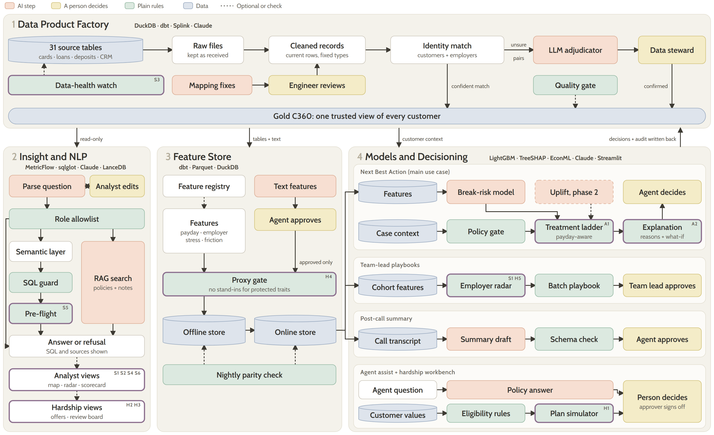
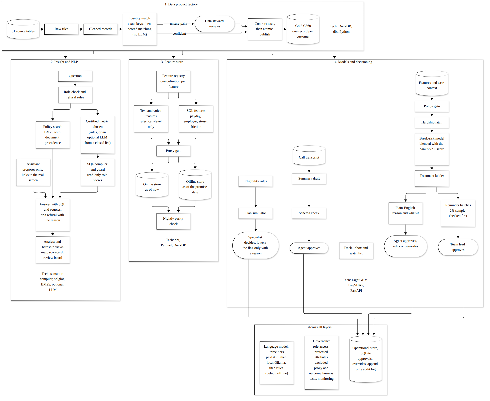

# back-on-track.ai

- **Event** - CIBC Collections Hackathon
- **Team** - Deep in Debt (Vishak Kashyap K)
- **Tagline** - *Every customer in one place, every answer in plain English, every next step explained and approved by a person.*

A collections platform on the synthetic Maple Bank dataset, with four layers working end to end:

1. **Data Product Factory:** raw to curated to golden C360, with customer ID matching across the five source systems and a match confidence.
2. **Insight and NLP:** plain-English questions answered over the C360, with the SQL or sources shown and out-of-scope questions refused.
3. **Feature Store:** structured and text features, one definition for training and live scoring.
4. **Next Best Action:** the Layer 4 use case, built in depth. A policy gate, a promise-break model, a treatment ladder and a plain-English explanation, with an agent who approves, edits or overrides every action.

**Judges:** the deliverables are listed in "Deliverables" below, and "Where each layer's required item is" maps every must-show item to the code, the screen and the evidence. The rest of the documentation is indexed in [`docs/README.md`](docs/README.md).

## The demo video and the pitch deck

**The demo video** is a tour of as much of the website as fits in 5 minutes. It signs in as each of the five personas in turn and shows their screens on the real dataset: the agent's queue, customer page and next best action with approve, change and override; the hardship board and plan simulator; Ask with its SQL, sources and a refusal; Track and the inbox; batch approvals and the stress test; and the data quality, fairness, monitoring and audit pages.

**The pitch deck** explains the business problem, the product and its novel features in 10 slides: the problem for collections teams, one architecture picture with the capabilities tagged on it, what is new for hardship and vulnerable customers, for analysts and team leads, and for agents, how a decision is made, why it can be trusted, and the business impact. Every number in it comes from the reports and documents in this repository.

## What is new, and where to see it

The brief's required items for each layer are mapped in "Where each layer's required item is" below. This table covers what we built beyond them. Each row names the screen where you can see it and the code behind it. Sign in at `/login` with the persona in brackets.

| What is new | Why it matters | See it in the app | Code |
|---|---|---|---|
| **Hardship latch.** Rules and models can raise a hardship flag but never lower it; only a hardship specialist can, and only with a written reason. A "possible" flag has a review deadline. | A customer in hardship must never be pushed for payment because a model changed its mind. | `/hardship/board` (hardship specialist) | `governance/hardship_latch.py` |
| **Plan simulator.** Try a hardship plan (length, payment, eligibility) for a real case and see the effect before saving anything. | The specialist can find an affordable plan with the customer, not by trial and error on the live account. | `/hardship/simulator/CS-2026-672507` (hardship specialist) | `decisioning/simulator.py`, `decisioning/eligibility.py` |
| **Policy gate before any model, then an explained next step.** The gate removes actions the policies forbid; the break-risk model only ranks what is left; every action has a plain-English reason and a what-if. | Compliance comes first by construction, and the agent can explain the action to the customer. | Next best action card on `/customers/G-JAT7827` (collections agent) | `decisioning/policy_gate.py`, `decisioning/ladder.py`, `decisioning/explain.py` |
| **Blended break-risk model.** Our model blended with the bank's v2.1 score. | Ranks better than either alone: AUC 0.772 against 0.694 for v2.1 on the same 25,617 test promises. | Risk and reasons in `/queue` (collections agent) | `models/ptp_break/` |
| **Reminder batches with a 2% sample.** A team lead checks a sample before a batch of reminders goes out. | Automation at scale without anything reaching a customer that a person has not approved. | `/team` (team lead) | `decisioning/nba.py` (`make_batches`, `sample_size`) |
| **Fairness gate that acts.** Feature groups that stand in for a protected ground (proxy test above 0.65) are dropped automatically; outcome gaps by group go to a person. | Fair treatment is checked on the data, not just promised. 0 pressure actions across 39,022 hardship or vulnerable cases. | `/governance/fairness` (data steward) | `governance/fairness/` |
| **Ask with its working shown.** Every answer shows the SQL or the policy sections it used; conflicting documents follow a precedence order, so the outdated FAQ never wins; refusals give the reason. | An analyst can trust and check every number, and nobody gets an answer from a superseded document. | `/ask` (strategy analyst) | `nlq/`, `semantic/`, `rag/` |
| **Post-call summary that checks itself.** The draft compares the promise the customer stated on the call with the recorded promise and highlights any mismatch; an approved summary with a hardship cue raises the latch. | Agents stop re-typing calls, and a hardship mention on a call is never lost. | Call page from the customer timeline (collections agent) | `decisioning/post_call.py` |
| **Assistant that proposes only.** It drafts the next step and links to the real screen, where a person decides. | The language model never acts on a customer by itself. | Assistant button in the header (any persona) | `decisioning/assistant/` |
| **Track, inbox and watchlist.** Follow a customer, case or batch over time, with a per-persona inbox. | Work that spans days (a hardship review, a plan) does not get lost between shifts. | `/track`, `/inbox` (any persona) | `api/`, `web/src/pages/` |
| **Three-tier language model.** A paid API (`gpt-6-luna`), then a local Ollama model, then rules that always answer. | The system works with no key and no network; the model only improves wording and matching. | The switch on `/ask` shows which tier is live | `llm/client.py` |
| **Broken-promise weather map.** Rate by postal area, aggregate only, areas under 10 customers hidden. | Shows where stress is building, for understanding only, never to treat an area differently. | `/map` (strategy analyst) | `api/`, `web/src/pages/` |
| **Tested, atomic data publish.** The nightly warehouse is built in a separate file, contract-tested, then swapped in; a failed test blocks it. | Agents never see half-built or broken data. | `/governance/quality` (data steward) | `pipeline/publish.py` |

## How to run it

**Requirements:** Docker with Compose v2, **or** Python 3.12 ([uv](https://docs.astral.sh/uv/)) and Node 20. About 20 GB of free disk.

**1. Get the data** (optional with Docker, which downloads it for you; about 2.3 GB zipped, 7 GB unzipped):

```bash
mkdir -p data/raw && cd data/raw
uvx --from 'huggingface_hub[cli]' hf download nuxsh/maple-collections-hackathon \
    maple_collections_release.zip --repo-type dataset --local-dir .
unzip -q maple_collections_release.zip && cd ../..
```

**2a. With Docker (recommended):**

```bash
docker compose up --build   # the whole system on http://localhost:8080
```

That one command builds the images, then a one-off `bootstrap` container downloads the dataset into `./data/raw` if it isn't there, builds the warehouse on the first run (about 5 minutes: ingest, silver, identity, gold + contract tests, features, quality report, benchmark), and exits. The API starts once it succeeds and the web once the API is healthy. Later runs find the data and start in seconds. `REBUILD=1 docker compose up --build` rebuilds the warehouse; `make test-containers` runs the tests in the image; `docker compose down` stops it.

**2b. Locally:**

```bash
cp .env.example .env
make setup               # Python + web dependencies
make data               # bronze, silver, identity, gold + contract tests, quality report, features
make benchmark          # answers every benchmark question -> deliverables/benchmark_answers.csv
make api                 # terminal 1: FastAPI on :8000
make web                 # terminal 2: http://localhost:5173
make test && make lint
```

Sign in at `/login` as one of five personas: collections agent, hardship specialist, team lead, strategy analyst or data steward. Each sees different screens. There's more detail and troubleshooting in [`docs/runbook.md`](docs/runbook.md).

## What changed from our design

Below are the diagram we submitted in the design phase and the one for what we built, drawn the same way so the two can be compared. The full list of 32 changes, with status, is in [`docs/design_changes.md`](docs/design_changes.md). The table after the diagrams covers the ones that matter most.

**Design phase (architecture_v1)**



**Build phase (final)**



How to read the final diagram: a rectangle is a step, a cylinder is stored data, a rounded box is a person deciding, and a dotted arrow is a suggestion that only links to a real screen. The more detailed written view is in [`docs/architecture/`](docs/architecture/).

| What changed | Business reason | Technical reason | Impact |
|---|---|---|---|
| **One use case.** Next Best Action only. Post-call summary and agent assist became supporting services inside it. | The brief asks for one use case, and a collections team needs one workflow it can trust, not three half-built ones. | Solo build in 36 hours; the critique flagged the scope. | One complete path from queue to reason to approval to audit, which is what the demo shows. |
| **Identity matching with no LLM.** Exact keys, then scored matching, then a steward reviews unsure pairs. The design had an LLM adjudicator. | A wrong merge means calling the wrong person about a debt, which is the worst error we can make. | LLM verdicts are hard to validate; weights from the scored model can be checked against known links. | 99.95% precision on the deterministic links, 1,020,000 CRM records resolved to 1,001,072 customers, and 99.2% of accounts linked. Unsure pairs wait for a person. |
| **Three-tier language model.** A paid API, then a local Ollama model, then rules that always answer. The design assumed Claude only. | Judges and the bank need the system to work without a key or a network, and paid models are allowed but not required. | Provider-agnostic client; authorisation and refusal rules run before any model; every prompt has an offline handler. | The rules alone score 0.994 on the development benchmark. On 24 unseen questions a local model mapped 12 of 15 paraphrases to the right metric, against 5 of 15 for rules, and declined all 9 that should be refused. |
| **Ask uses a semantic compiler and BM25.** MetricFlow and a LanceDB vector store were replaced. | Answers must be repeatable and auditable: the same question gives the same SQL, and the SQL and sources are shown. | A certified-metric compiler is deterministic; the policy corpus has only 19 documents, so ranking by authority mattered more than embeddings. | Every answer shows its SQL and sources or refuses with a reason. Conflicting documents follow a precedence order. |
| **Safer database access.** Read-only connection, table allowlist, role views and blocked personal columns, with sqlglot as a second line. | Customer data must not leak to the wrong role. | A parser miss cannot expose a column that the connection cannot read. | While testing we found that any agent could open any customer; row-level checks now stop it, and the tests cover it. |
| **Operational writes in SQLite.** Approvals, overrides and an append-only audit log, not a side file merged nightly. | An approval must show up immediately, and every decision needs a record that cannot be edited. | DuckDB has one writer; triggers make the audit table append-only. | Approvals and overrides are visible at once, and each one has an audit number. |
| **Fairness gate that acts.** A feature group above 0.65 proxy AUC is dropped and sent to review; outcome gaps by group go to a person. The design said drop or coarsen. | Fair treatment is a stated rule, and base rates differ between groups, so a gap needs judgement, not an automatic fix. | Proxy test per feature group, plus outcome tests on action, contact and cure rates and on calibration. | No group is above the line (highest 0.58). Across 39,022 hardship or vulnerable cases there were 0 pressure actions, and one group ("separated", 0.73 times the overall rate) goes to a person. |
| **Model comparison with a blend.** Evaluation against the bank's v2.1 plus calibration and top-decile precision. We blend our model with v2.1. | Capacity is limited, so ranking quality at the top of the list is what matters. | A blend of our model and the bank's score ranks better than either alone. Our first model scored 0.95 because of a leak, which we found and removed. | On the same 25,617 test promises the blend reaches AUC 0.772, against 0.712 for our model alone and 0.694 for v2.1. |
| **Feature store with one definition.** One dbt macro is evaluated as of the promise date for training and as of now for live scoring. Text and voice features come from rules. | Agents and the model must see the same facts, and text features must be explainable. | Parity check recomputes 1,000 online rows; rules were measured on the release's public labels. | 0 mismatches in the parity check, and 99.6% hardship accuracy on 500 labelled transcripts. |
| **The headline extra is the plan simulator, not the employer radar.** The radar was dropped; a weather-style map of broken promises by area was added. | The data shows no employer or regional cluster for the layoffs (Windsor-Essex payroll delay 7.3% against 7.8% elsewhere), so a radar would report nothing real. | The simulator is fully supported by program rules; the map hides areas under 10 customers and is aggregate only. | A hardship specialist can try a plan without saving anything. The map is for understanding only and never used to treat customers differently. |
| **React frontend and a Docker Compose modular monolith.** Streamlit and a laptop setup were replaced; no microservices. | Approve and override flows, role-based screens, and a demo that starts with one command. | `web` (nginx), `api` (all layers) and `jobs` (batch); the nightly warehouse is tested, then swapped in atomically. | `docker compose up --build` starts the whole system; a failed contract test blocks publishing. |
| **Business value restated.** About 14,400 new cases a month, not 2,800. | The design used an estimate made before the data was profiled. | Counted from the cases table. | Two more points of 30-day cure is about 290 more cures a month, roughly CAD 2.1M a year, as an estimate to refine on matured cohorts. |

Things that are new since the design phase and not in the diagram we submitted: the Track pages, the inbox and the saved watchlist, the assistant that proposes actions and links to the real screen, and an independent spec test suite written by a separate agent that saw only the brief and the design documents.

## Data quality

We found **17 issues affecting 5,755,151 records** (a record can sit under more than one issue) in the Maple Bank synthetic release (snapshot 28 Sep 2026). Each one was detected with a check, handled in the pipeline and tied to a contract rule where it applies. The report is regenerated from the warehouse on every run by `governance/quality_report.py`. Here are the headline items; the full list of 17, with how each was detected and handled, is in [`docs/data_quality_report.md`](docs/data_quality_report.md).

| Issue | Records affected | How we handled it |
|---|---:|---|
| Each system writes names, birth dates, phones and postal codes in its own format | 2,844,500 | A parser per source gives one normalised identity record |
| Snapshot month-end dates in three different formats | 1,255,152 | All formats parsed; slash dates disambiguated by the quarter-end day |
| Date of birth in a non-ISO raw format | 405,432 | Used the clean column; the raw value is kept for lineage |
| Partly masked card phone numbers | 384,422 | Compared on the visible digits only |
| Mistyped CRM ID in account snapshots | 328,891 | Account linked by majority vote over its valid CRM IDs |
| Core-banking CIF lost its leading zeros | 156,837 | Left-padded to 10 digits before any join |
| Duplicate CRM records for one person | 37,856 | Clustered into one golden ID; consent is the most restrictive of the records |
| Accounts that could not be linked to a customer | 15,024 | Left unlinked (precision first); candidates go to the steward review queue |
| Promises due during the INC-0914 app outage | 617 | Excluded from model labels; a caveat on Ask answers that cover 14 Sep |

**Identity resolution:** 1,020,000 CRM records became 1,001,072 golden customers, and 1,829,476 of 1,844,500 accounts (99.2%) are linked. Precision comes first, because a wrong merge means contacting the wrong person about a debt, so we under-merge rather than over-merge. **Contract tests:** 11 of 11 pass on `gold.c360_customer`.

## Data contract

The contract for the golden customer table is below in full. The same file is in the repo at [`docs/contracts/c360_customer.v1.yaml`](docs/contracts/c360_customer.v1.yaml). It follows the structure of the release's example contract DC-COLL-001: owner, refresh, schema, quality rules, allowed uses and not-allowed uses. Its status is `draft`, because a few details (such as the exact retention period) are marked to be confirmed.

<details>
<summary>Show the data contract (DC-COLL-C360-001, gold.c360_customer)</summary>

```yaml
# Data contract: gold.c360_customer (DC-COLL-C360-001), deliverable 3.
# Structure follows the release's example contract DC-COLL-001 (files/docs/data_contracts/DC-COLL-001_v1.0_EN.md):
# owner, refresh, quality rules, allowed uses, not allowed. Extended with schema, grain, SLA and lineage.
# Narrative: docs/design/system_design_files/collections_system_design_V1.md Part 3.
contract_id: DC-COLL-C360-001
based_on: DC-COLL-001
product: gold.c360_customer
version: "1.0"
status: draft            # draft until profiling confirms the TBCs
owner: Head of Collections Analytics
steward: Collections Data Engineering lead
policy_approver: Collections Policy Office
grain: one row per golden_id (resolved person), current state
source_systems:          # the five systems with their own customer key (release README "Customer keys")
  - {system: CRM, key: customers.crm_customer_id, note: "a person can have two records"}
  - {system: Cards, key: card_accounts.src_customer_ref, note: card-system customer number}
  - {system: Lending, key: loan_accounts.src_customer_ref, note: borrower number}
  - {system: Core banking, key: "deposit_accounts.src_customer_ref, external.bank_subject_ref, bureau_history.bank_subject_ref", note: "10-digit CIF, keep leading zeros"}
  - {system: Collections, key: "collections_cases.coll_customer_ref (CRM ID copied at case open)", note: "also contact_history / promises_to_pay / agent_notes.crm_customer_id"}
consumers: [agent workspace, Collections Ask (semantic layer), NBA feature table, employer radar, fairness audit view]
refresh: daily batch after source extracts, landed by 06:30 ET; hardship_flag and consent changes event-driven in production
freshness_sla: _refreshed_at no older than 26 hours; alert to steward on breach
retention: follows source retention (7 years on notes and recordings); exact period TBC
schema:
  - {name: golden_id, type: string, pii_class: none, source_rule: "generated; stable across reruns"}
  - {name: crm_customer_ids, type: "array<string>", pii_class: internal_key, source_rule: "customers.crm_customer_id via identity_xref"}
  - {name: match_method, type: enum, pii_class: none, source_rule: "deterministic / probabilistic / reviewed"}
  - {name: match_confidence, type: "decimal(4,3)", pii_class: none, source_rule: "lowest link probability in the cluster"}
  - {name: display_name, type: string, pii_class: direct_pii_masked_for_analysts, source_rule: "preferred_name else first_name + last_name"}
  - {name: phone_token, type: string, pii_class: direct_pii_tokenised, source_rule: primary_phone_e164}
  - {name: email_token, type: string, pii_class: direct_pii_tokenised, source_rule: "email (verified, not bounced)"}
  - {name: province_code, type: enum, pii_class: quasi_identifier, source_rule: customers.province_code}
  - {name: fsa, type: string, pii_class: quasi_identifier, source_rule: customers.fsa}
  - {name: time_zone, type: string, pii_class: quasi_identifier, source_rule: "customers.time_zone checked against geo_reference.time_zone"}
  - {name: preferred_language, type: enum, pii_class: quasi_identifier, source_rule: customers.preferred_language}
  - {name: consent_call, type: boolean, pii_class: none, source_rule: "most restrictive across linked records"}
  - {name: consent_sms, type: boolean, pii_class: none, source_rule: "most restrictive across linked records"}
  - {name: consent_email, type: boolean, pii_class: none, source_rule: "most restrictive across linked records"}
  - {name: consent_push, type: boolean, pii_class: none, source_rule: "most restrictive across linked records"}
  - {name: permitted_call_start_local, type: "string HH:MM", pii_class: none, source_rule: customers.permitted_call_start_local}
  - {name: permitted_call_end_local, type: "string HH:MM", pii_class: none, source_rule: customers.permitted_call_end_local}
  - {name: contact_block, type: enum, pii_class: none, source_rule: "none/cease/insolvency/deceased/represented from cease_communication_flag, bankruptcy_flag, consumer_proposal_flag, deceased_flag, credit_counselling_agency_flag, legal_representative_flag"}
  - {name: hardship_flag, type: enum, pii_class: sensitive_not_protected, source_rule: "none/possible/clear from collections_cases.hardship_flag, hardship_mentioned_flag, hardship_signal"}
  - {name: vulnerability_flag, type: boolean, pii_class: sensitive_not_protected, source_rule: "customers.vulnerability_flag, collections_cases.vulnerable_customer_flag"}
  - {name: dispute_open_flag, type: boolean, pii_class: none, source_rule: "dispute_status = open or card_accounts.dispute_open_flag"}
  - {name: employer_key, type: string, pii_class: quasi_identifier_tokenised, source_rule: "customers.employer_name matched to deposit_accounts.payroll_descriptor_raw (S1)"}
  - {name: payroll_delay_days, type: int, pii_class: none, source_rule: "max deposit_accounts.payroll_delay_days"}
  - {name: max_dpd, type: int, pii_class: none, source_rule: "max dpd over open accounts in c360_account"}
  - {name: total_past_due_cad, type: "decimal(12,2)", pii_class: none, source_rule: "sum past_due_amount over open accounts"}
  - {name: open_case_id, type: string, pii_class: none, source_rule: "collections_cases.case_id where case_status = open (values TBC)"}
  - {name: _refreshed_at, type: timestamp, pii_class: none, source_rule: pipeline run time}
quality_rules:
  - {id: 1, rule: "golden_id is unique and not null", severity: error, test: "unique + not_null on golden_id"}
  - {id: 2, rule: "match_confidence in [0,1] and >= auto cut-off unless deterministic or reviewed", severity: error, test: dbt_utils_free_range}
  - {id: 3, rule: "max_dpd > 0 implies total_past_due_cad > 0 (max_dpd = 0 with > CAD 1 past due: warn)", severity: error, test: TODO}
  - {id: 4, rule: "consent flags never null and never more permissive than any linked current CRM record", severity: error, test: "not_null + TODO"}
  - {id: 5, rule: "no golden_id links two different non-null national_id_hash values", severity: error, test: TODO}
  - {id: 6, rule: "every current CRM record maps to exactly one golden_id; every c360_account row has one primary party", severity: error, test: TODO}
  - {id: 7, rule: "every drop of hardship_flag to none has a hardship_flag_events row with reviewer and reason", severity: error, test: TODO}
  - {id: 8, rule: "no protected-attribute column exists in this table", severity: error, test: contract_no_protected_columns}
  - {id: 9, rule: "_refreshed_at within the last 26 hours", severity: error, test: contract_freshness}
  - {id: 10, rule: "employer_key match rate >= 90% on the transactions.payroll_employer_key sample (TBC)", severity: warn, test: TODO}
  - {id: 11, rule: "no customer-facing decision uses a feature older than its freshness SLA", severity: error, test: "tests/constraints (policy gate)"}
allowed_uses:
  - "Collections servicing: the agent view and NBA"
  - "Collections analytics and reporting"
  - "Employer monitoring, in groups of 10 or more"
  - "Training and monitoring collections models"
  - "Fairness audits through the restricted view"
not_allowed:
  - "Marketing or cross-selling"
  - "Credit decisions or limit changes"
  - "Any purpose outside collections"
  - "Contacting customers not yet behind, without Policy Office sign-off"
  - "Exporting direct PII outside the restricted zone"
  - "Joining protected attributes back in for decisions"
  - "Sending raw PII to an external LLM"
```

</details>

## Benchmark results

All benchmark answers are in [`deliverables/benchmark_answers.csv`](deliverables/benchmark_answers.csv): 50 rows with the columns `question_id, answer, sql_or_sources, refused`. They come from three sets:

| Set | Question ids | Count | Gold answers available |
|---|---|---:|---|
| Release, dev split | BQ-002 to 007, 010 to 012, 016 to 019, 022, 024, 026, 028, 031, 032, 034, 035 | 21 | Yes (`labels/benchmark_dev_answers.csv` in the release), so we can score these |
| Release, test split | BQ-001, 008, 009, 013 to 015, 020, 021, 023, 025, 027, 029, 030, 033 | 14 | No, scored by the organisers |
| Extra questions released on 4 Oct (`benchmark_questions_extra.csv` in the repo root) | BQ-101 to BQ-115 | 15 | No, checked by hand against the documents and data |

Seven questions are refused, each with its reason: BQ-018, 023, 024, 029, 031, 101 and 106.

The system produced every answer, with no hand edits. Each answer comes with the SQL it ran, or the policy sections or call transcript it quotes. The submission run used Ask with the language model on (`gpt-6-luna`). The model only words policy answers from quoted sections and helps match unusual questions to a certified metric. Refusals, access checks and every number come from the rules and the certified metric SQL, so the numbers are the same without a key.

| Check | Result |
|---|---|
| Dev split (21 questions with gold answers, our approximation of the scorer) | 0.994 with rules only, 0.986 with the model (two policy answers worded differently) |
| Extra questions, first run at 18:30 (rules only, before fixes) | 4 of 15 right |
| Extra questions, final run (checked by hand against the documents and data) | 15 of 15 answered or refused as we believe is correct |
| Tests after the fixes | Unit and constraint tests pass; the independent spec suite passes 650 of 650 |

The first run on the extra questions showed six gaps, which we fixed in the system and not in the file. Three measures were missing (total overdue, average days to cure, payment-link click rate). Promises could not be split by channel. There were no filters for a hardship flag or an insolvency hold. The word "fraudulent" did not find the fraud paragraph. A question about prioritising churchgoers was refused for the wrong reason: "going to" read as a forecast instead of religion as a protected ground. Every fix is general (a new metric, filter, synonym or rule order), and the 35 original answers are unchanged except for two dropped unrelated citations and one refusal that now gives a different reason. The per-question table, with sources and what changed, is in [`docs/benchmark_results.md`](docs/benchmark_results.md).

## AI tools we used, and for what

Details are in [`docs/ai_tools.md`](docs/ai_tools.md).

**To build the project:**
- **Claude Code** (Claude Sonnet 5.5 and Claude Opus 5.5) for planning, scaffolding, code, tests, Docker and documentation. Every change is reviewed by the team member and gated by tests.
- **A separate Claude Code subagent** for the independent spec test suite.
- **The Figma connector**, to read a community landing-page design as visual inspiration.
- **Claude Code plugin skills** (Render, design, dataviz).

**Inside the product:**
- **A paid language model, optional** (OpenAI `gpt-6-luna`, Anthropic `claude-haiku-4-5-20251001`; any provider can be set in `.env`) for: matching unseen phrasings to a certified metric, writing guarded SQL for questions no metric covers, wording answers from retrieved policy, notes and call text, and the tool-choosing assistant agent. Fallback: a local Ollama model, then the rules.
- **Offline rules and templates** for everything else, and as the always-available tier: question parsing, insights, text features, post-call summaries.
- **Search over policies, 760,594 agent notes, 25,000 call transcripts and the speech-to-text of 2,000 recordings** (BM25, access-filtered, with citations).
- **Whisper (faster-whisper, local)** to transcribe the voice recordings.
- **LightGBM with SHAP** for the promise-break model.
- **Plain code**, deliberately, for the policy gate, treatment ladder, eligibility, simulator, explanations, refusals and the hardship latch.

## Where each layer's required item is

The repository is [vishakkashyapk30/bring-em-back-on-track](https://github.com/vishakkashyapk30/bring-em-back-on-track) (private; the organisers are collaborators). Sign in at `/login` as one of the five personas: collections agent, hardship specialist, team lead, strategy analyst or data steward.

| Layer | Must show (official) | Where in the code | Where in the app | Evidence |
|---|---|---|---|---|
| 1 Data Product Factory | Raw to curated to golden C360 pipeline (code) | [`pipeline/ingest.py`](pipeline/ingest.py) (bronze), [`pipeline/models/silver/`](pipeline/models/silver/) (typed + standardised), [`pipeline/models/gold/`](pipeline/models/gold/) (C360) | Customer page: `/customers/G-JAT7827` | `make data` builds it end to end |
| 1 | Customer ID matching across the five source systems, with a match confidence | [`identity/run.py`](identity/run.py), [`identity/cluster.py`](identity/cluster.py), [`identity/matching.py`](identity/matching.py) | Identity and lineage panel on the customer page | 1,020,000 CRM records resolve to 1,001,072 golden IDs; 99.2% of 1.84M accounts linked; scored matcher 99.95% precision on deterministic links ([`docs/data_quality_report.md`](docs/data_quality_report.md) §2) |
| 1 | Data quality checks | dbt contract tests in [`pipeline/tests/`](pipeline/tests/) and [`pipeline/models/gold/schema.yml`](pipeline/models/gold/schema.yml); [`governance/quality_report.py`](governance/quality_report.py) | `/governance/quality` | 11 contract tests pass; 17 issues reported with record counts |
| 2 Insight and NLP | Plain-English questions answered over the C360 | [`nlq/pipeline.py`](nlq/pipeline.py), [`semantic/registry.py`](semantic/registry.py), [`semantic/compiler.py`](semantic/compiler.py), [`rag/`](rag/) | `/ask` (sign in as analyst) | Dev benchmark 0.994 rules only, 0.986 with the model (our scorer, [`docs/benchmark_results.md`](docs/benchmark_results.md)) |
| 2 | The SQL or source shown with every answer | Same | "How I got this" on every answer | `sql_or_sources` column in the benchmark CSV |
| 2 | Out-of-scope questions refused | [`nlq/refusal.py`](nlq/refusal.py), [`nlq/guard.py`](nlq/guard.py), [`nlq/executor.py`](nlq/executor.py) | Ask refusal card | All refusal questions in the benchmark refused, with reasons |
| 3 Feature Store | Features from structured data and from text or voice | [`features/registry.yaml`](features/registry.yaml), [`features/extract_text.py`](features/extract_text.py), [`features/text_rules.py`](features/text_rules.py) | `/features` (catalog), customer feature vector | 70 features (text and voice); text features validated on the release's 500 public labels each (transcripts: 99.6% hardship accuracy, 98% exact summaries; notes: 95%) ([`docs/reference/feature_store.md`](docs/reference/feature_store.md)) |
| 3 | One definition used for both training and live scoring | [`pipeline/macros/ptp_features.sql`](pipeline/macros/ptp_features.sql) used by [`f_ptp_offline`](pipeline/models/features/f_ptp_offline.sql) and [`f_ptp_online`](pipeline/models/features/f_ptp_online.sql); [`features/parity.py`](features/parity.py) | n/a | Parity check: 1,000 sampled online rows, 0 mismatches across 38 columns |
| 4 Models and Decisioning | A working model or agent; plain-English explanation of each decision; a point where a human reviews or overrides | [`models/ptp_break/`](models/ptp_break/), [`decisioning/`](decisioning/) | Customer page: Next best action card (approve / edit / override), e.g. `/customers/G-JAT7827` | Blend AUC 0.772 against 0.694 for the bank's v2.1; every action approved, edited or overridden by a person and audited |

**Verify it yourself:**

```bash
docker compose up --build   # one command: fetches the dataset if missing, builds the warehouse once, serves http://localhost:8080
make benchmark          # regenerate deliverables/benchmark_answers.csv and score the dev split
make test               # unit, API and constraint tests
SPEC_ADAPTER=tests_spec.adapter_impl:make_adapter uv run pytest tests_spec   # independent spec suite (650 of 650 pass in offline mode)
```

## Deliverables

| # | Deliverable | Where |
|---|---|---|
| 1 | Code repository and this README | this repo |
| 2 | Architecture diagram | Both diagrams are inserted in this README (the design-phase one and the final one, under "What changed from our design"). The image files are also in the repo: [`docs/architecture/`](docs/architecture/) (the final architecture is `architecture_final_v2.png` with its Mermaid source `architecture_final_v2.mmd`; the earlier vertical draft `architecture_final.png` and the detailed `architecture.png` and `.pdf` are there too) and [`docs/design/diagrams/architecture_v1.png`](docs/design/diagrams/architecture_v1.png) |
| 3 | Data contract (golden C360, based on DC-COLL-001) | Shown in full in this README (see "Data contract") and also in the repo as [`docs/contracts/c360_customer.v1.yaml`](docs/contracts/c360_customer.v1.yaml) |
| 4 | Data quality report | Summarised in this README (see "Data quality") and also in the repo, in full, as [`docs/data_quality_report.md`](docs/data_quality_report.md) |
| 5 | Benchmark answers (35 release questions and the 15 extra ones) | [`deliverables/benchmark_answers.csv`](deliverables/benchmark_answers.csv). Results are summarised in this README (see "Benchmark results") and in full in [`docs/benchmark_results.md`](docs/benchmark_results.md) |
| 6 | Demo video (under 5 minutes) | [Google Drive: demo video](https://drive.google.com/open?id=16DMe4Y6hV0HE1jRjvSuVD1PzzK8QfiOQ). A tour of as many features across the website as fit in 5 minutes, signed in as each persona (see "The demo video and the pitch deck") |
| 7 | Pitch deck (10 slides, PDF) | [Google Drive: pitch deck PDF](https://drive.google.com/open?id=1yN4p9IidXRo8o6ANz9HOaakeGGNMr6mZ). It covers the problem, the product, the novel features, trust and the business impact. |

## Repository layout

| Path | What |
|---|---|
| `common/` | Config, DB connections (DuckDB read-only, SQLite ops), enums, the protected-attribute list |
| `pipeline/` | Layer 1: bronze ingest, dbt project (silver, gold, role views, features, contract tests), atomic publish |
| `identity/` | Layer 1: deterministic links, Splink, steward review, stable golden IDs |
| `semantic/`, `nlq/`, `rag/` | Layer 2: metrics, question to chips to guarded SQL to answer, cited policy answers |
| `features/` | Layer 3: registry, offline and online stores, point-in-time joins, parity, text rules |
| `models/ptp_break/`, `decisioning/` | Layer 4: promise-break model; NBA gate, ladder, allocator, explanation; supporting services |
| `governance/` | Audit log, hardship latch, access control, quality report, monitoring, fairness |
| `llm/` | Provider-agnostic LLM client (offline default), prompts, schemas, redaction |
| `api/` | FastAPI routers, schemas (the API contract), sample-data fixtures |
| `web/` | React + Vite + Tailwind app |
| `docs/` | Brief, design-phase submission, contracts, reports, architecture, runbook |
| `Dockerfile`, `compose.yaml`, `docker/` | Containers |
| `render.yaml` | Optional hosted demo on Render (not deployed) |

## Ground rules we enforce

- No protected attributes in decisions (enforced by constraint tests in the test suite).
- Every decision comes with a plain-English reason.
- A person can review and override anything that affects a customer.
- Signs of financial hardship pause pressure actions until a specialist reviews them.
- Every customer-affecting action is written to an append-only audit log.

All data is synthetic (Maple Bank, snapshot 28 Sep 2026).
