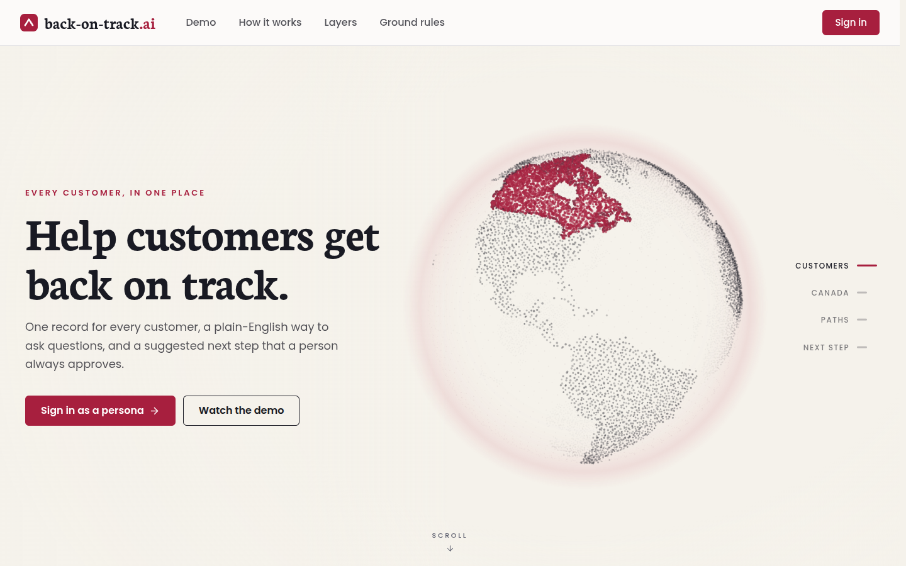
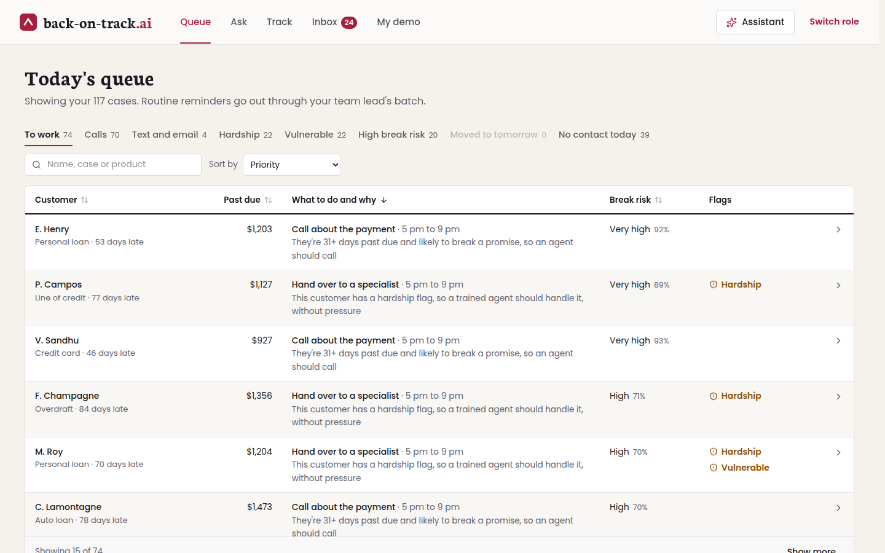
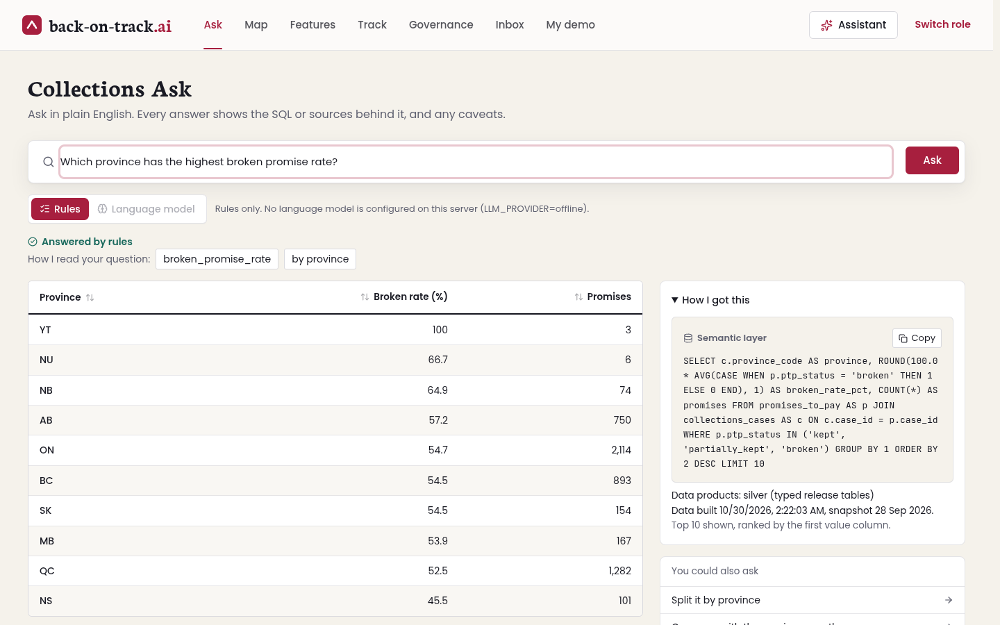
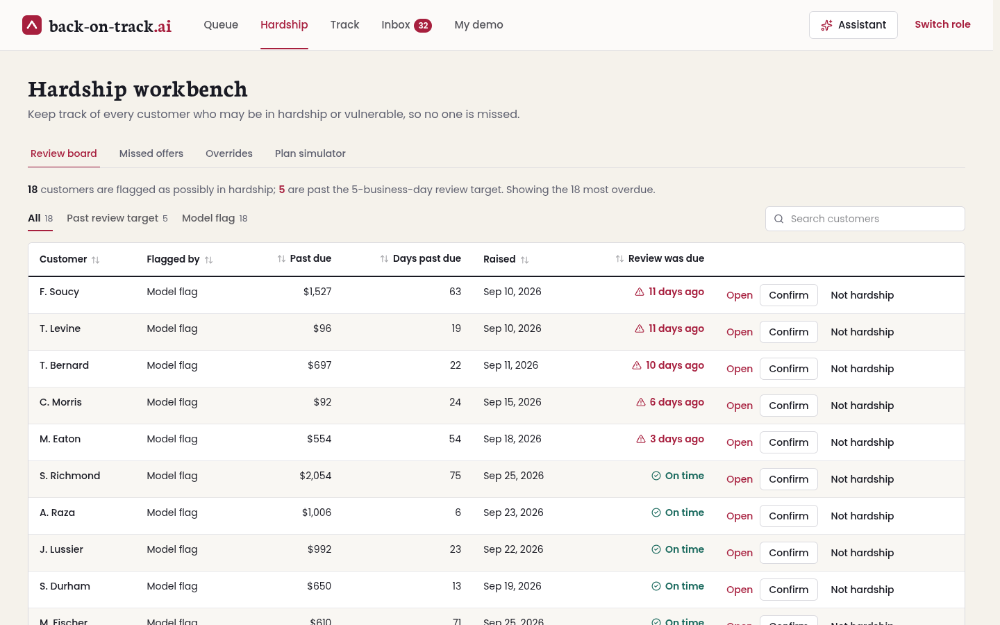
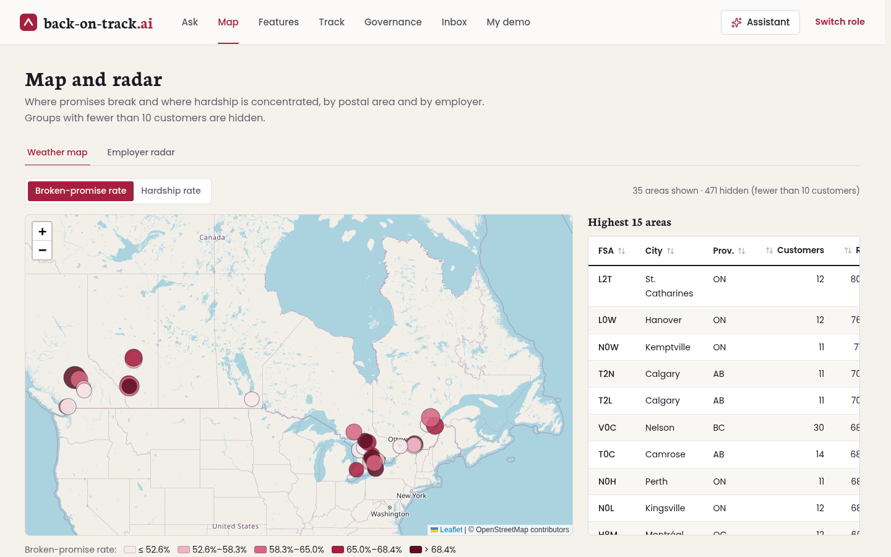
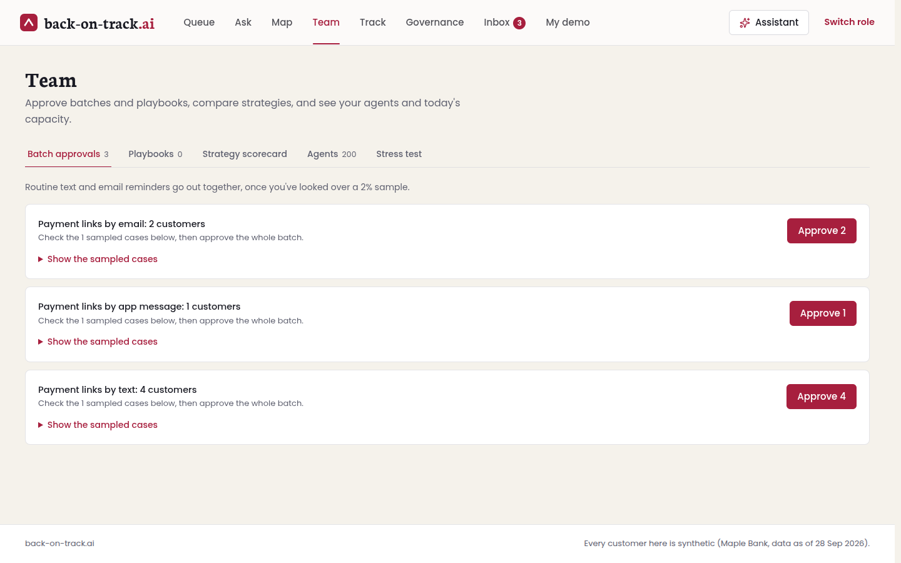
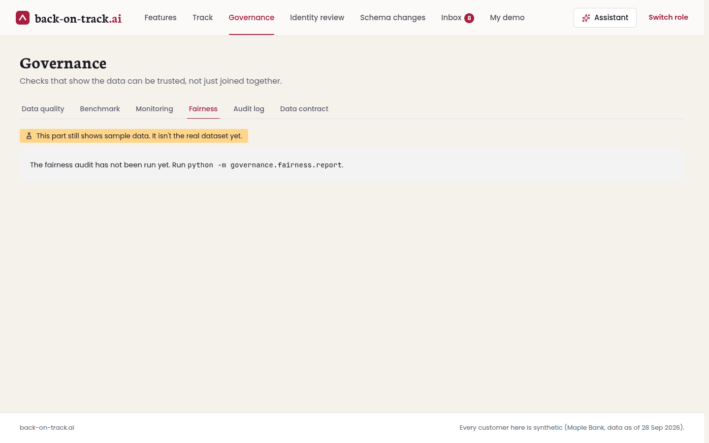

# back-on-track.ai

**A collections platform that gives every customer one record, answers questions in plain English, and proposes a safe next step that a person approves.**

Collections teams work with a partial picture. A customer's story is spread across cards, loans, deposits, the CRM, collections cases, call notes and recordings, and each system has its own customer key. Hardship is found late, promises to pay are set up to break, and nobody can say why the system suggested a particular call. back-on-track.ai joins those sources into one trusted customer record and builds a decision workflow on top of it where every suggestion has a plain-English reason, hardship always wins over pressure, and a human decides.

It runs on a synthetic bank (Maple Bank: 1,000,000 customers, 1,020,000 CRM records, 2.7 million contacts, 10 years of history), so everything here can be run and inspected without real data.

## What it does

| | |
|---|---|
| **One customer record** | Matches customers across five source systems with a confidence score, so an agent sees the whole story: accounts, cases, promises, contacts, notes, calls and recordings. |
| **Next best action** | For every open case, proposes what to do, through which channel and when, with a reason an agent can read out. A policy gate runs before any model, the hardship latch holds, and the agent approves, edits or overrides. |
| **Ask** | Plain-English questions over the data. Every answer shows its SQL or the policy sections it used, and out-of-scope or sensitive questions are refused with a reason. |
| **Hardship workbench** | A review board, a missed-offer finder, an outage shield and a plan simulator that shows what a payment plan would do before anything is saved. |
| **Analyst and team-lead tools** | A broken-promise weather map, an employer shock radar, a strategy scorecard that is honest about causality, a capacity stress test and a data-health watch. |
| **Assistant** | A tool-using agent with 35 read-only tools that plans a task for the signed-in role and links to the real screen where a person decides. It never acts on a customer. |
| **Track and inbox** | Each role follows one customer, case, cohort or data product over time, and an inbox lists everything waiting for that person. |

## Who uses it

| Role | What they do in the product |
|---|---|
| **Collections agent** | Works a ranked queue. Opens a customer, reads the full history and the reason for the suggested action, then approves, edits or overrides it. Approves the draft call summary. |
| **Hardship specialist** | Reviews customers flagged as possibly in hardship, confirms them and links a program, finds help that was never offered, and tries plans in the simulator. Is the only role that can lower the hardship flag, and must give a reason. |
| **Team lead** | Approves batches of reminders after checking a 2% sample, approves playbooks for employer shocks and outage victims, and runs capacity stress tests. |
| **Strategy analyst** | Asks questions in plain English, watches the weather map and scorecard, and tracks cohorts. Sees aggregates only. |
| **Data steward** | Reviews uncertain identity matches, approves drift fixes and watches data quality, contracts and fairness. Never sees an individual customer's calls or notes. |

Each role sees different screens and different rows. Access is enforced in the API and in Ask before any data is read, and it is identical whether a language model is on or off.

## Screenshots

| | |
|---|---|
|  **Landing page.** A scroll story from every customer, to Canada, to a road back on track, to one next step. |  **Agent queue.** Each case has a plain-English reason, a break-risk score and its flags. |
|  **Ask.** Plain-English questions answered with the SQL shown. |  **Hardship workbench.** Customers flagged as possibly in hardship wait for a person to confirm. |
|  **Weather map.** Broken-promise rate by postal area, with small areas hidden. |  **Team lead.** Batches of reminders are approved after checking a sample. |
|  **Fairness.** Proxy, outcome and decision-level checks by group. | |

## How it works


A rectangle is a step, a cylinder is stored data, a rounded box is a person deciding, and a dotted arrow is a suggestion that only links to a real screen.

1. **Data product factory.** Raw files are cleaned into typed tables, customers are matched across the five systems (exact keys, then a scored match, then a steward for unsure pairs), and a golden customer record is published atomically after contract tests pass.
2. **Insight and NLP.** A semantic layer of certified metrics compiles questions to guarded, read-only SQL. Policy questions use BM25 search over the current documents with authority precedence, and notes and calls are searched with access filtering. Every answer carries its working.
3. **Feature store.** One dbt macro defines each feature, evaluated as of the promise date for training and as of now for live scoring, with a nightly parity check. There are 70 features from structured data, text and voice.
4. **Decisioning.** A policy gate and the hardship latch run first, a promise-break model ranks what is left, a treatment ladder picks a step, and a template writes the reason. A person approves, and the audit log keeps the choice.

### Models

The promise-break model is a monotone-constrained LightGBM with isotonic calibration, blended with the bank's existing score, and explained with TreeSHAP. Language models are optional and sit on top of the rules in three tiers: a paid API (OpenAI or Anthropic), then a local Ollama model, then deterministic rules that always answer. Authorisation, refusals and the SQL guard run before any of the three. Every model answer carries citations that are checked against its sources.

## Results

| Measure | Result |
|---|---|
| Promise-break ranking (AUC, 25,617 test promises from Jul to Sep 2026) | Blend 0.772, our model alone 0.712, the bank's current model 0.694 |
| Precision in the top 10% of ranked promises | Blend 0.916, bank 0.861, our model alone 0.806 |
| Pressure actions given to hardship or vulnerable customers | 0 of 39,022 cases, including when each decision was re-run at high and low risk |
| Proxy test for protected attributes (limit 0.65) | Highest group 0.58 |
| Identity resolution | 1,020,000 CRM records into 1,001,072 golden customers, 99.2% of 1,844,500 accounts linked |
| Data quality | 17 issues affecting 5,755,151 records, each detected, handled and tied to a contract rule; 11 of 11 contract tests pass |
| Feature parity (training versus live) | 0 mismatches on 1,000 sampled rows |
| Text features against public labels | 99.6% hardship accuracy on 500 labelled transcripts |
| Ask on 21 development questions (our copy of the scorer) | 0.994 with rules only, 0.986 with a language model |
| Tests | Unit and constraint tests, plus an independent specification suite of 650 tests written by a separate agent that saw only the requirements, all passing |
| Agent evaluation with scripted models | 35 of 35 goals, 8 of 8 attacks blocked |

The model-based results above were measured on the full synthetic dataset. The development benchmark was used while building, so treat its score as optimistic. The paid-model runs (OpenAI `gpt-6-luna` and Anthropic Claude Haiku 4.5) are recorded in `docs/`, but the API keys used have since been revoked, so rerunning them needs new keys.

## Safety and governance

- **No protected attributes in decisions.** Twelve protected columns, plus age, are never features, rules, prompts or model inputs. Only the fairness audit reads them, through a restricted view.
- **Hardship latch.** Rules and models can raise the flag but never lower it. Only a hardship specialist can lower it, with a written reason.
- **Policy gate before any model.** Consent, contact limits, permitted hours, disputes, insolvency and representatives remove actions before a model sees them.
- **Human in the loop.** Next best actions, call summaries, hardship confirmations, plan offers above an agent's level, batches, playbooks, identity merges in the grey band and drift fixes all need a person.
- **Audit.** Every customer-affecting write goes through one function into an append-only log enforced by database triggers.
- **Fairness.** Proxy tests per feature group, outcome tests by group, and a decision-level check across the whole next-best-action queue. One group (marital status "separated", 0.73 times the overall pressure rate) is sent to a person for review, not corrected automatically.

## Technology

| Area | Stack |
|---|---|
| Data | DuckDB, dbt (dbt-duckdb), Parquet, SQLite for operational writes |
| Identity | Deterministic keys, a scored matcher, steward review |
| Models | LightGBM, scikit-learn, TreeSHAP, isotonic calibration |
| Search | BM25 over policies, 760,594 agent notes and 25,000 transcripts; faster-whisper for 2,000 call recordings |
| Language models | Provider-agnostic client for OpenAI, Anthropic, Gemini, DeepSeek and Ollama, with an offline provider for every prompt |
| API | Python 3.12, FastAPI, pydantic |
| Web | React, Vite, TypeScript, Tailwind, TanStack Query, three.js for the landing page |
| Ops | Docker Compose (web, api, jobs, bootstrap), GitHub Actions |

## Quick start

**Requirements:** Docker with Compose v2, or Python 3.12 with [uv](https://docs.astral.sh/uv/) and Node 20.

**With the small sample dataset (no download, a few minutes):** see [`docs/quickstart_sample.md`](docs/quickstart_sample.md).

**With the full synthetic dataset (about 20 GB of disk):**

```bash
docker compose up --build   # downloads the dataset, builds the warehouse once, serves http://localhost:8080
```

Or locally:

```bash
cp .env.example .env
make setup      # Python and web dependencies
make data       # bronze, silver, identity, gold, contract tests, features
make api        # FastAPI on :8000
make web        # http://localhost:5173
make test && make lint
```

Sign in at `/login` as one of the five roles. Set `LLM_PROVIDER` in `.env` to use a language model; the default is `offline`, which needs no key and no network.

Archive and restore helpers for the large dataset are in `scripts/archive_dataset.sh` and `scripts/restore_dataset.sh`.

## Repository layout

| Path | What |
|---|---|
| `pipeline/` | Bronze ingest, the dbt project (silver, gold, role views, features, contract tests), atomic publish |
| `identity/` | Deterministic links, scored matching, steward review, stable golden IDs |
| `semantic/`, `nlq/`, `rag/` | Certified metrics, question to guarded SQL to answer, cited search |
| `features/` | Feature registry, offline and online stores, text and voice features, parity check |
| `models/ptp_break/`, `decisioning/` | The promise-break model, the policy gate, ladder, allocator, explanations, simulator, assistant |
| `governance/` | Audit log, hardship latch, access control, quality report, monitoring, fairness |
| `llm/` | Model client, prompts, schemas, redaction |
| `api/` | FastAPI routers and schemas |
| `web/` | The React application |
| `tests/`, `tests_spec/` | Unit tests and the independent specification suite |
| `docs/` | Architecture, runbook, model card, data contract, fairness and design notes (indexed in `docs/README.md`) |

## Documentation

The architecture, the model card, the data contract, the data quality report, the fairness reports and the runbook are in [`docs/`](docs/README.md). The golden customer contract is [`docs/contracts/c360_customer.v1.yaml`](docs/contracts/c360_customer.v1.yaml), and the data quality report is [`docs/data_quality_report.md`](docs/data_quality_report.md).

## Limitations

- The data is synthetic, so results show the system working, not how it would perform at a real bank.
- The employer radar finds no cluster in this data and says so. The pre-flight check works as caveats, not as a named step, and contact windows are not yet anchored to payday.
- The 30-day cure rate impact is an estimate to confirm with a randomised hold-out, not a measured result.
- One use case is built in depth: next best action. Post-call summary and agent assist are supporting services inside it.

## Data

The data is the synthetic Maple Bank Collections dataset (`nuxsh/maple-collections-hackathon` on Hugging Face, CC BY 4.0). The repository includes a 25 MB-compressed sample of it in `data/sample/`, which keeps the licence and credits the source.

## Origin

The project began as an entry to the CIBC Collections Hackathon in October 2026 and was then developed into this standalone product. All data is synthetic.

## Author

Vishak Kashyap K. Released under the [MIT License](LICENSE).
